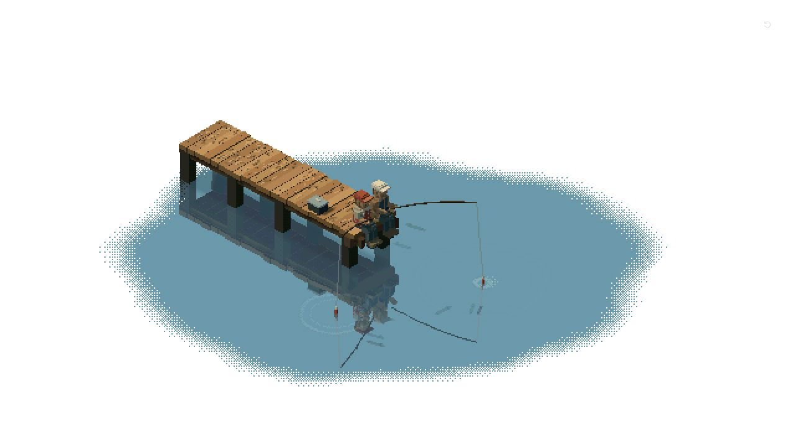

# 静水 · Quiet water

真实 Three.js / WebGL 像素风钓鱼微缩场景。所有木桥、人物、鱼竿、鱼线、鱼漂与鱼均为程序化几何；没有背景截图、生成图片或视频素材。

[在线试玩 / Live demo](https://mianc869-cpu.github.io/quiet-water-diorama/)



## 运行

需要 Node.js 20.19+ 或 22.12+。

```sh
npm install
npm run dev
```

打开终端显示的本地地址。生产构建：`npm run build`，预览构建：`npm run preview`。

## 操作

- 悬停人物、鱼竿或鱼漂：指针提示可交互。
- 点击人物或鱼竿：抛竿；落水时出现涟漪。
- 等待鱼漂晃动、下沉，在下沉后约 3 秒内点击鱼漂或按空格收线，累计捕获数。
- 空格作用于最近选中的鱼竿；咬钩时自动选中对应鱼竿。
- 点击水域：在落点产生实时波纹。
- 滚轮 / 双指捏合：有限平滑缩放。
- 右上角回转图标：恢复相机初始缩放。

## 模块

```text
src/
  SceneSetup.ts          正交相机、灯光、渲染器、适配
  FishingPier.ts         木板、木纹、桥柱、渔具盒
  Characters.ts          两位有衣着和面部细节的体素人物
  WaterShader.ts         水域边缘、动态波带、平面倒影
  WaterSimulation.ts     带阻尼的二维波动方程与随机风扰动
  FishSystem.ts          九条独立游动的鱼
  FishingInteraction.ts  Raycaster、抛竿 / 咬钩 / 收线状态机、触摸
  PixelRenderPipeline.ts 低分辨率 RenderTarget、NearestFilter、量化
  UIOverlay.ts           计数、提示、视角重置
  model.ts               共享模型资源、按材质合并静态体素
  main.ts                RAF、delta time、resize 与 dispose
  style.css
```

## 渲染实现

场景首先渲染到低分辨率的 `WebGLRenderTarget`，使用 `NearestFilter` 放大；后处理加入颜色量化。水域边界使用 4×4 Bayer ordered dithering 的像素丢弃，保持纯白背景和硬像素边缘。水面使用 160×160 固定时间步的带阻尼二维波动方程，随机微风和点击、鱼漂落水不断注入扰动。波面梯度驱动亮纹和倒影扭曲，并叠加短暂局部涟漪。边缘使用低幅缓变噪声，使像素颗粒缓慢进退。

水面每帧使用镜像正交相机重新渲染真实几何到独立反射纹理，以多尺度平流噪声、域扭曲和局部涟漪扰动采样，避免周期性扫描线和锯齿；倒影保留连续轮廓，Bayer 网点用于水纹及水域边缘过渡。桥下另有克制的接触遮蔽层。静态体素按材质合并，几何、材质和渲染目标在销毁时释放。

## 近似与限制

这是针对截图的程序化近似，并非原场景资产的逐像素复原。单张截图无法恢复原视频的时序、水波参数和被遮挡的几何。水体采用平面动态着色与实时反射，并非体积流体模拟；水下鱼是放在水面上方的半透明、低对比度几何轮廓，模拟水下观感，不含物理折射。颜色量化使用有限 RGB 色阶，未强制匹配一套固定手绘色表。捕获数量保存在本次页面会话内。

## 许可证

本项目采用 [MIT License](LICENSE)。Three.js 等第三方依赖遵循各自的许可证。

## 网页预览部署

GitHub Pages 从 `main` 分支的 `/docs` 目录发布。修改源码后运行 `npm run build -- --base=./`，将 `dist/` 内容同步到 `docs/` 并提交即可更新网页。
